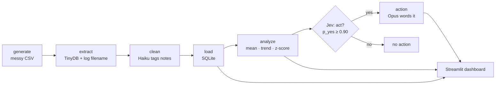
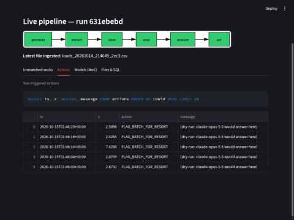
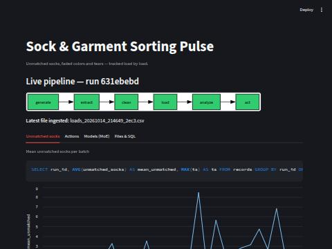

# Sock & Garment Sorting Pulse

Every household has a sock drawer with orphans in it. Mine has about fifteen. For
years I assumed that was just how laundry works -- socks go in, fewer socks come
out, nobody knows why. Then I started writing down what came out of each load, and
the orphans turned out to cluster. Some loads lose nothing. Some loads lose six at
once. That is not entropy, that is a PATTERN, and patterns can be measured.

This project is an agentic data pipeline that watches that pattern. Every minute it
ingests a new batch of load records, cleans up the mess a human typed, stores it,
runs three statistics on it, and when the number of unmatched socks goes abnormal,
it takes a visible action.

**Repo:** https://github.com/chrispecoraro/laundry-sorting
**Live dashboard:** _paste your `https://<app>.streamlit.app` URL here after deploying_

---

## The pipeline



Six steps. Each one logs itself to the `pipeline_runs` table, which is what makes
the flow chart on the dashboard light up in real time instead of being a picture.

---

## Step 1 — Generate the messy file

`src/generate_fake_data.py` writes one CSV per cycle into `data/incoming/`. It is
messy ON PURPOSE, because real operator data is:

| Mess | Example |
|---|---|
| Three date formats | `2026-10-14 21:43`, `10/14/2026 09:43 PM`, `2026-10-14T21:43:00` |
| Five spellings of one machine | `Washer 1`, `washer1`, `WASHER 1` |
| Blank fields | `pairs_out` left empty |
| Typo'd numbers | `170` socks in one load (stray zero -- it was 17) |
| Free text | `"one of the striped pair missing!!"` |

About 12% of batches are bad batches, where unmatched socks jump from roughly 0.8
per load to roughly 8. That is the signal the rest of the pipeline has to find.

## Step 2 — Extract to TinyDB

`src/extract.py` reads each new file and drops the rows into TinyDB (a JSON
document database -- no schema, no types, nothing forced) exactly as typed. The
filename goes into a `files` table and into `pipeline_runs.filename`, so the
dashboard can always tell you which file it just ate. Already-seen files are
skipped, which is what makes "run every minute" safe.

## Step 3 — Clean

`src/transform.py` does the unglamorous work: parse mixed dates, map the five
machine spellings down to three machines, pull numbers out of `"14 socks"`, and
throw out any sock count above 60 as a data-entry error.

Order matters here. We kill the outliers FIRST, then fill the gaps with the median,
then average. Average first and one stray zero swamps the whole batch.

Then the metric itself:

```
unmatched_socks = socks_in - (2 × pairs_out)
```

The free-text note is the part a database cannot handle, so Claude Haiku reads all
of them in one batched call and returns a `defect` (`faded`, `torn`,
`missing_sock`, `wear`, `none`) plus a severity.

## Step 4 — Load into SQLite

`src/load.py` writes typed rows into `db/clean.sqlite` -- `records`,
`pipeline_runs`, `model_calls`, `actions`, `stats`. The insert statement itself is
returned and logged, so the dashboard can show you the exact SQL that ran. The
table is trimmed to the last 2,000 rows, because this file gets committed to the
repo every five minutes and nobody wants a 400 MB repository.

## Step 5 — Analyze (three methods, formulas on screen)

`src/analytics.py`, over the mean unmatched socks per batch:

1. **Descriptive** — mean and standard deviation.
2. **Trend** — least-squares slope across batches. Is this getting worse?
3. **Anomaly** — z-score of the latest batch against everything before it.

Each one returns its LaTeX formula alongside its number, and the dashboard prints
both side by side. A statistic you cannot see the formula for is a statistic you
cannot argue with.


One gotcha worth stating plainly: batches are ordered by `MIN(rowid)`, not by
timestamp. The fake timestamps are truncated to the minute, so sorting by time
scrambles the batch order and the z-score ends up comparing the wrong "latest".

## Step 6 — Act on the statistic

`src/actions.py`. When `|z| > 2.0`, two different kinds of model get involved:

- **System 1 — Jev** (`src/jev_client.py`): fast, typed, with a calibrated
  confidence number. Should we flag this batch, yes or no? Below `p_yes = 0.90`
  it escalates to a human instead.
- **System 2 — Claude Opus**: slow reasoning. Writes the two-line note a person
  actually reads.

The result is a row in the `actions` table, which the dashboard renders as a red
banner and a red `act` node in the flow chart.



Jev is waitlist-only right now, so with no `JEV_API_KEY` set the client falls back
to Claude Haiku returning the same JSON shape. Be honest about what that costs
you: the fallback's confidence number is a guess, not a calibrated probability.
Jev's RLCD training is the whole point of the 0.90 threshold meaning anything.

## Step 7 — The dashboard

`app/streamlit_app.py`, refreshing every 60 seconds.



Four tabs: the metric and its stats, the actions log, the Mixture-of-Experts
panel, and the raw run log. Every chart ships with the SQL that produced it.

## Step 8 — Mixture of Experts

`src/moe_router.py` routes each task to the cheapest model that does it well:

| Task | Expert | Why |
|---|---|---|
| `clean` | Claude Haiku | Tagging 20 short notes. Volume, not depth. |
| `analyze` | Claude Sonnet | Explaining the stats in plain English. |
| `decide` | Claude Opus | High stakes. It writes the thing a human acts on. |

To be precise about the term: this is an app-level router over several models, not
the Mixture-of-Experts architecture inside a single model. Same name, different
floor of the building.

Every call is logged to `model_calls` with tokens and latency, so the dashboard can
show who did what, when, and for how much.

---

## Running it

```bash
python -m venv .venv && .venv/bin/pip install -r requirements.txt
cp .env.example .env          # add ANTHROPIC_API_KEY (optional -- see below)
.venv/bin/python -m src.agent --iterations 5 --interval 60
.venv/bin/streamlit run app/streamlit_app.py
```

With no `ANTHROPIC_API_KEY`, the router runs in dry-run mode: it returns
placeholder text, still logs the call, and the pipeline still works end to end.
The grade never depends on having credits.

## Hosting

- **GitHub Actions** (`.github/workflows/etl.yml`) runs the agent on a cron and
  commits the SQLite file back to the repo. GitHub's minimum cron is five minutes
  and it runs late under load, so the job fires every 5 minutes and loops 5 times
  at 60-second intervals inside.
- **Streamlit Community Cloud** serves the dashboard. Its disk is ephemeral, so
  the app never writes to SQLite -- it downloads the committed file from
  `raw.githubusercontent.com` using the `DB_URL` secret.

## Scoreboard

Requirements tracked on a 5×5 bingo card: [`BINGO.md`](BINGO.md) (or open
`bingo.html`). Regenerate with:

```bash
python scripts/bingo_check.py .
```
